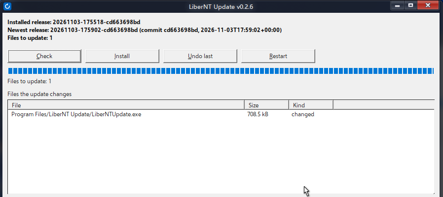

# LiberNT Update

[](https://github.com/nks-hub/libernt-update/actions/workflows/ci.yml)
[](https://github.com/nks-hub/libernt-update/releases)
[](https://github.com/nks-hub/LiberNT)
[](client/build.cmd)
[](server/luup.py)
[](LICENSE)

Updates an installed [LiberNT](https://github.com/nks-hub/LiberNT) system to a newer build file by file, with backups and rollback, instead of reinstalling it.



[Architecture](docs/ARCHITECTURE.md) · [Operations](docs/OPERATIONS.md) · [Screenshots of an update from upstream](docs/SCREENSHOTS.md)

[Goals and work progress](docs/PROGRESS.md) tracks the current limitation fixes and their verification.

`server/luup.py` runs on the build machine: it reads `LiberNT.img` (`ninja liberntimg`), hashes the serviced files and publishes a signed release. `client/` builds `LiberNTUpdate.exe` (Win32, C++17, static CRT), which runs inside LiberNT, and `luupboot.exe`, a native program that replaces files at boot. The client speaks Czech on a Czech system and English elsewhere.

## Features

- 🔏 **Signed feed** - the release index is checked against the Ed25519 key compiled into the client; manifests, files and registry snapshots are checked by SHA-256.
- 🔍 **Diff against the disk** - only files whose contents differ from the release are downloaded, whatever build the machine started from.
- 🧩 **Setup variants** - the kernel and HAL keep the variant Setup installed (`ntoskrnl.exe` copied from `ntkrnlmp.exe` on multiprocessor machines).
- 🔁 **Boot-time replacement** - when any changed file is in use, `luupboot.exe` replaces the transaction at the next boot, before Win32 starts. Newer SMSS builds run it in `UpdateExecute` after the registry is initialized; older builds support file updates through `BootExecute`.
- 🗂️ **Registry defaults** - signed factory snapshots supply new driver and service settings. Updates compare old defaults, new defaults and the installed values, preserve local configuration and keep guarded rollback records.
- ✅ **Boot verification** - the `LiberNTUpdate` service checks every replaced file after the restart and rolls the update back when one does not match; a rollback restores only the files that actually changed.
- 🛟 **Recovery after a failed boot** - when two boots after an update never reach the service, `luupboot.exe` restores the previous files on the third. During an update `freeldr.ini` gets the entry "LiberNT (undo the last update)", which starts the previous kernel and HAL and undoes the update at once.
- 🔄 **Automatic updates** - the service checks the feed (every 6 hours by default), installs what it finds and restarts at 3:00 when an update waits for a restart. A tray icon announces updates and offers the restart.
- 🆙 **Self-update** - every release carries the newest client from GitHub releases. The running client is renamed aside and replaced without a restart; its previous exe restarts the service and rolls the update back when the new client does not keep running for 30 seconds.
- 🥾 **Boot loaders** - `freeldr.sys`, `rosload.exe`, `bootx64.efi` and `bootmgfw.efi` from the image's boot partition replace the installed ones (system drive root on BIOS installs, EFI system partition on UEFI); `BCD` is never touched.
- 📦 **Only real changes** - a file that differs from the previous release only in build metadata (PE time stamps, checksum, debug ids, build tag) keeps its previous contents, and a build that changes nothing real is not published; an upstream merge of 30 commits went from 1520 changed files to 516.
- 🚫 **No retry loops** - a release that failed or was rolled back on a machine is not installed again automatically; the window or `/install` retries it.
- 📝 **Logging** - every step, every failed file, every undo and every line `luupboot.exe` could not apply goes to `%ProgramData%\LiberNTUpdate\update.log`.
- ⏪ **History** - each update keeps a backup of the files it replaced; the last update can be undone, a pending one cancelled, and every transaction is listed.

## Requirements

- Build machine: Python 3.12+ with PyNaCl, 7-Zip (`7z`) and a configured LiberNT build tree. It runs wherever LiberNT is built; Linux (Debian 13, `python3-nacl`, `p7zip-full`) is what `build-release.sh` and the systemd units assume.
- Client build: Visual Studio 2022 or newer with the x64 C++ tools and the Windows SDK (`ntdll.lib` for `luupboot.exe`).
- Target: LiberNT amd64.
- Registry servicing also requires an SMSS build with `UpdateExecute` and a verified factory registry baseline.
- Update server: any static HTTP server; `server/docker/` has an nginx container.

## Installation

Create the signing key once and put its public half into the client:

```sh
python3 server/luup.py keygen --key /opt/luup/signing.key     # prints the public key
```

Replace `kFeedPublicKeyHex` in `client/src/pubkey.h` with that key and build on Windows (`LNTU_FEED_URL` and `LNTU_VERSION` are optional):

```bat
set LNTU_FEED_URL=http://updates.example.org/
client\build.cmd
```

Copy `client\out\LiberNTUpdate.exe` and `client\out\luupboot.exe` into LiberNT (`C:\Program Files\LiberNT Update\`) and enable automatic updates:

```bat
start "" /wait "C:\Program Files\LiberNT Update\LiberNTUpdate.exe" /register
```

## Configuration

`%ProgramData%\LiberNTUpdate\config.json`:

```json
{"feedUrl": "http://updates.example.org/", "root": "C:\\", "auto": "install", "checkMinutes": 360, "restartHour": 3}
```

| Key | Meaning |
|---|---|
| `feedUrl` | feed address; overrides the one compiled in |
| `baseRelease` | verified installed release ID, required for the first update when `state.json` does not record it; the client refuses to guess |
| `bootRoot` | administrator-selected boot partition path when automatic EFI identification refuses an ambiguous or unsupported disk layout; check and install use the same mapping, including offline feeds |
| `registryBaseRelease` | original factory hive release for an older installation whose registry baseline was not recorded; this is separate from later file updates |
| `auto` | `install` checks and installs, `notify` only checks (the tray icon announces it), `off` |
| `checkMinutes` | interval of the automatic check |
| `restartHour` | local hour of the automatic restart for a pending update, `-1` never |
| `language` | `cs` or `en`; without it the window, tray and messages follow the Windows UI language (Czech, otherwise English) |

An update applied by `BootExecute` needs two restarts. The first replaces files after the old kernel has loaded; the second starts the new files. The recovery entry and rollback plan stay available until the second boot is confirmed. Restarting the service does not confirm a new boot. `/cancel` is accepted only before replacement starts.

## Usage

Publish a release from a finished build and check the feed:

```sh
python3 server/luup.py publish --key /opt/luup/signing.key --feed /srv/luup \
        --img output-Clang-amd64-debug/LiberNT.img --commit "$(git rev-parse HEAD)" --repo . \
        --client /path/to/unpacked/client/release
python3 server/luup.py verify  --feed /srv/luup --pub "$(cat /opt/luup/signing.pub)"
```

Inside LiberNT, `LiberNTUpdate.exe` without arguments opens the window. The command line does the same work:

| Command | Action |
|---|---|
| `/check` | compare the newest release with this system and list the changed files |
| `/install` | install it; files in use are replaced at the next restart |
| `/restart` | restart the computer |
| `/rollback` | undo the most recent update |
| `/cancel` | withdraw an update that waits for a restart |
| `/finalize` | finish a pending update (the service does this at boot) |
| `/history` | list past updates |
| `/register` | register the service and the tray icon |
| `/status` | result of the last automatic check |
| `/version` | client version |
| `/selftest` | built-in checks |

The program is a GUI-subsystem executable, so command-line output also goes to `%ProgramData%\LiberNTUpdate\cli-output.txt`; from `cmd.exe` run it with `start "" /wait LiberNTUpdate.exe /check`.

Older installations with user-writable updater data require `/migrate-legacy` before this client can use the data folder. The [migration procedure](docs/OPERATIONS.md#migrate-legacy-updater-data) preserves an archive and starts with automatic installation off.

When an update icon is present, right-click it and choose **Pin this icon** to keep it outside the overflow. The choice applies only to this icon and can be changed later in the same menu or by dragging it. Announcements use the system notification center.

## Releases

- **Client** - a version tag such as `v0.3.0` builds and publishes a stable client; `v0.3.0-rc.1` publishes a prerelease without changing GitHub's latest stable release. Both carry `LiberNTUpdate.exe`, `luupboot.exe` and `SHA256SUMS` (`.github/workflows/release.yml`).
- **System** - `server/build-release.sh` fetches branch `nks` of nks-hub/LiberNT and the newest client release (checked against `SHA256SUMS`), runs `ninja liberntimg` and publishes when the LiberNT commit or the client version is new. With `FEED_PUSH=user@host:` it copies the feed to the update server with rsync, objects first and the signed `feed.json` last. `server/systemd/luup-release.timer` runs it daily at 04:30 UTC, after the fork's GitHub workflow has merged upstream `main-nt10` into `nks` at 03:17 UTC.

```sh
install -m 755 server/build-release.sh /opt/luup/build-release.sh
cp server/luup.py /opt/luup/
cp server/systemd/luup-release.* /etc/systemd/system/
systemctl daemon-reload && systemctl enable --now luup-release.timer
```

`SRC`, `OUT`, `FEED`, `KEY`, `LUUP`, `CLIENT_REPO`, `CLIENT_CACHE`, `FEED_PUSH` and `PUSH_KEY` override the defaults.

## Update server

```sh
cd server/docker && mkdir feed && LUUP_PORT=8080 docker compose up -d
```

nginx serves `feed/` read-only with `no-cache` on `feed.json` and long caching for the immutable `objects/` and `releases/`. Clients can use plain HTTP: the feed is signed and every file is checked by hash.

## Limitations

- Older SMSS builds support file updates only. Registry servicing needs an OS bootstrap update with `UpdateExecute`, the registry-capable client and a verified factory baseline; see [migration order](docs/OPERATIONS.md#enable-registry-servicing).
- A boot-start driver that crashes before smss runs stops `luupboot.exe` too; the recovery entry starts the previous kernel and HAL but the new boot drivers. Take a VM snapshot before trying risky builds.
- A new boot loader that does not start cannot be undone from inside the system; its backup stays in the transaction folder.
- Automatic EFI detection requires one ESP, a FAT filesystem, the LiberNT loader and agreement with the firmware boot device. A conflicting Setup value is refused; an absent one is allowed. Multiple ESPs require an administrator-verified `bootRoot`. Loader update and rollback passed on OVMF with an MBR disk and Secure Boot disabled; GPT and physical UEFI hardware still need runtime tests.

## Testing

```sh
python3 server/luup.py test      # diff, dedup, exclusions, variants, boot files, client overlay, skipped release, signature
```

```bat
client\build.cmd
start "" /wait client\out\LiberNTUpdate.exe /selftest
type %ProgramData%\LiberNTUpdate\cli-output.txt
```

The client self-test covers SHA-256 and Ed25519 vectors, direct install, rollback (including a partly applied update), the boot plan as `luupboot.exe` applies it, the boot-failure and recovery-entry rollbacks, `/cancel`, and a full check against a signed local feed with kernel variants.

The HTTP probe serves synthetic signed feeds on a temporary loopback port. It checks legacy fallback before v2 adoption, rejection of HTTP 403/500 and invalid signatures, prevention of a later protocol downgrade, and the response size limit:

```bat
client\tests\build_boot_vm.cmd
client\out\boot_vm.exe feed-http
```

CI runs the publisher tests, client self-test and HTTP probe on every push. These checks do not replace boot and tray tests on LiberNT.

## Contributing

1. Fork the repository
2. Create a feature branch (`git checkout -b feature/my-change`)
3. Commit your changes (`git commit -m "feat: add my change"`)
4. Push the branch (`git push origin feature/my-change`)
5. Open a pull request

## Support

- 📧 **Email:** dev@nks-hub.cz
- 🐛 **Bug reports:** [GitHub Issues](https://github.com/nks-hub/libernt-update/issues)

## License

MIT License — see [LICENSE](LICENSE) for details. Monocypher (`client/third_party/monocypher`, BSD-2-Clause or CC0) and nlohmann/json (`client/third_party/nlohmann`, MIT) keep their licences.

---

<p align="center">Made with ❤️ by <a href="https://github.com/nks-hub">NKS Hub</a></p>
