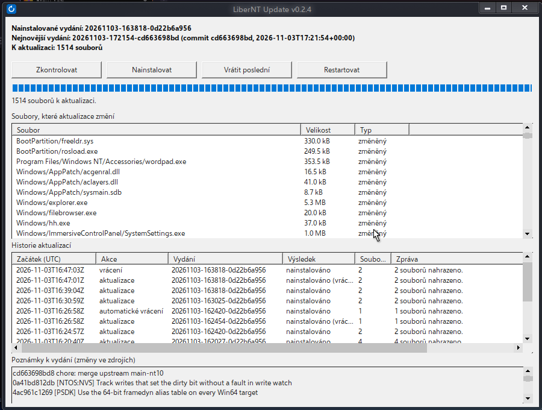
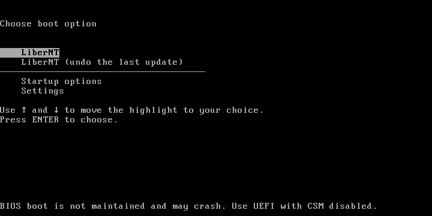
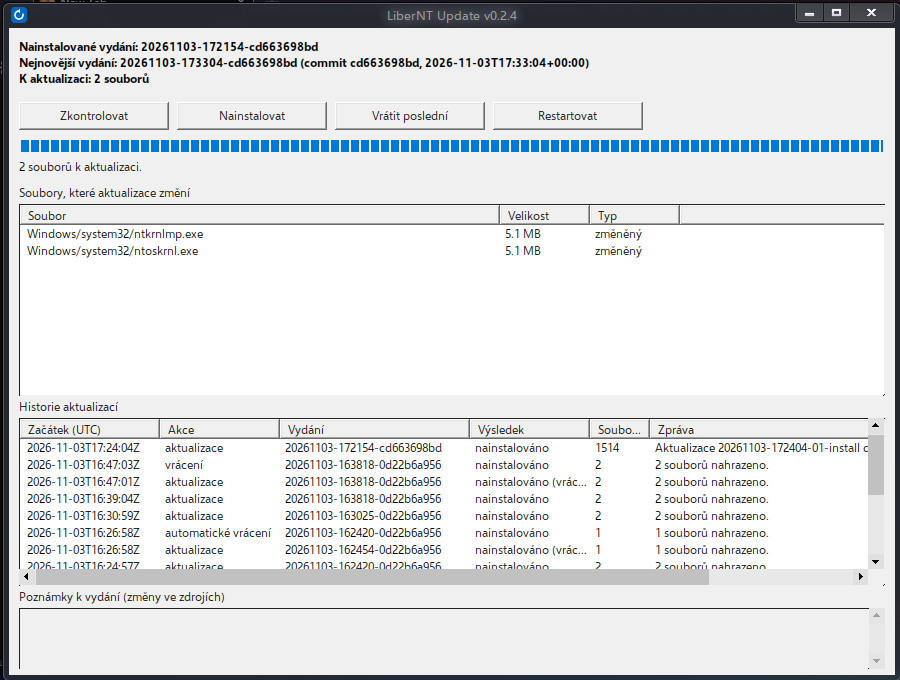

# An update from upstream changes

Recorded on 3 November 2026 on a LiberNT amd64 VM (BIOS, 2 CPUs) running client v0.2.4. The fork's `Sync upstream` workflow merged 30 upstream commits (up to `0a41bd8`, 65 changed source files) into `nks` as `cd663698bd`; `build-release.sh` built the image and published release `20261103-172154-cd663698bd`.

## 1. The update is offered



The window compares the release with the disk: 1514 files differ on this machine. The notes at the bottom are the commit subjects between the installed and the new release. This release was published before the build-metadata filter existed; with the filter the same upstream merge carries 516 changed files (1004 of the 1520 rebuilt files differ only in time stamps, checksums, debug ids and the build tag).

## 2. Waiting for the restart


`/install` downloaded and checked all 1514 files. Most of them were in use, so nothing was replaced yet: the client wrote the boot plan and its undo, and the tray icon announces that the update finishes at the next restart (automatically at 3:00).

## 3. Boot menu during the update



While the update is pending, `freeldr.ini` has the entry **LiberNT (undo the last update)**. It starts the previous kernel and HAL and makes `luupboot.exe` restore the previous files. The default entry boots normally.

## 4. After the restart



At boot `luupboot.exe` moved 1514 of 1514 files (`luupboot: plan done 1514 failed 0`), the service verified every file and recorded the release as installed. The next release, built from the same commit after reconfiguring so that the build tag names the commit, changes only the two kernel variants: everything else differs only in build metadata and keeps the previous contents, so the machine downloads 10 MB instead of the whole system.

`update.log` of this update:

```
17:25:44Z tx 20261103-172404-01-install pending restart
17:25:46Z tray: icon shown for pending:20261103-172404-01-install
17:29:14Z luupboot: plan done 1514 failed 0 line 0 status 0
17:29:29Z tx 20261103-172404-01-install install installed: Aktualizace ... dokončena po restartu (1514 souborů).
17:29:30Z service: client v0.2.4 running
```
